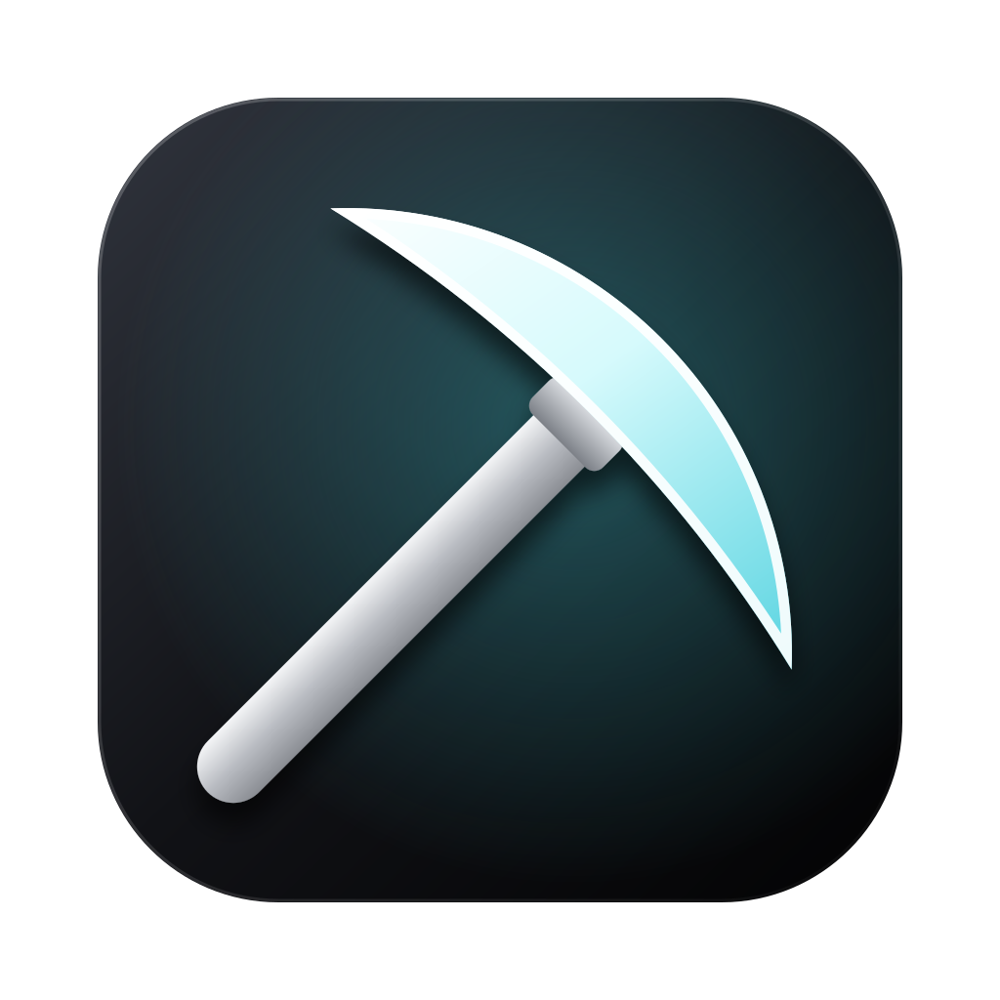

# Kiln

<p align="center">
  
  
  
  <a href="https://github.com/Cetirzine/kiln-launcher/releases/latest"></a>
  <a href="https://github.com/Cetirzine/kiln-launcher/releases"></a>
  <a href="https://github.com/Cetirzine/kiln-launcher/stargazers"></a>
  <a href="LICENSE.md"></a>
</p>

[English](README.en.md)

为 Mac 与 Apple 芯片打造的 Minecraft: Java Edition 启动器，SwiftUI 原生实现。

## 特点

**Apple 芯片优先**

| 游戏版本 | 运行方式 |
| --- | --- |
| 1.19 及以上 | 版本自带 arm64 原生库，使用 arm64 Java 原生运行 |
| 1.13 ~ 1.18 | 自动将 LWJGL 3.1/3.2 替换为带 arm64 原生库的 3.3.1，原生运行 |
| 1.12.2 及以前 | 自动替换为 arm64 版 LWJGL 2（MinecraftMachina 构建），并下载 arm64 的 Java 8（Azul Zulu），原生运行 |

关闭“原生运行旧版本”或无法获取 arm64 Java 时，才通过 Rosetta 2 运行 x86_64 Java。

**性能**

- 按 Java 版本调优的 G1 参数（可选分代 ZGC），初始堆为最大堆的一半
- Java 25+：AOT 缓存（JEP 483/514/515），首次运行后启动更快；Java 19~24：动态 CDS 归档
- 为启动器下载的 Java 运行时生成基础 CDS 归档（Mojang 运行时默认没有）
- Java 24+：紧凑对象头，减少堆内存占用
- 快速校验：文件未变化时跳过 SHA-1 计算
- 游戏进程以高 QoS 运行，优先调度到性能核心
- 默认使用官方源下载，BMCLAPI 镜像作为备用（可在设置中切换）；失败的文件会降低并发自动重试，适应代理环境

**Metal 渲染（实验性）**

选择 Fabric 或 Quilt 时，可一键安装 [MetalUniversal](https://github.com/EternityQwQ/MetalUniversal)（Modrinth：metallum-mc），以 Apple Metal 代替 OpenGL / Vulkan 渲染。游戏退出时会把 `preferredGraphicsBackend` 写回为 `opengl`，因此 Kiln 每次启动前都会把它恢复为 `default`（即优先使用 Metal）。目前只支持该 Mod 适配的游戏版本（26.2）；NeoForge / Forge 暂无 Metal 渲染 Mod。

**启动器功能**

- 原版、Fabric、Quilt、Forge、NeoForge 安装（包括 1.20.1 的 NeoForge；Forge / NeoForge 运行安装器 processors，思路参考 [HMCL](https://github.com/HMCL-dev/HMCL)）
- 安装 Forge 时可同时加装 OptiFine 与 LiteLoader（只在该游戏版本有对应组件时显示）
- 离线账号、微软账号与外置登录（LittleSkin 等 authlib-injector 皮肤站，不保存密码）；多账号一键切换（⌃⌘1～9），每个版本可固定使用某个账号
- 皮肤：离线账号可使用本地皮肤或同名正版玩家的皮肤；微软账号可上传皮肤、切换披风
- 正版档案：修改玩家名称（实时检查能不能用，显示下次可改名的时间），查看拥有的游戏（买断 / Game Pass）、多人游戏 / Realms / 聊天权限和联机封禁状态
- 自动选择 / 下载 Java（Mojang 官方运行时、Azul Zulu）
- 版本独立游戏目录、独立 Java / 内存 / 参数设置
- Modrinth 与 CurseForge（经 MCIM 镜像，可填写官方 API 密钥）的 Mod、资源包、光影搜索与下载，Mod 可按加载器筛选；安装时自动补全前置 Mod
- 已安装的 Mod 自动识别并检查更新，可逐个或一键更新
- 整合包：安装 Modrinth（.mrpack）与 CurseForge 整合包，导出为 .mrpack；作者禁止第三方下载的文件会优先从 Modrinth 获取同一文件
- 从其他启动器导入：Prism Launcher、MultiMC / PolyMC（实例文件夹或导出的 .zip）、CurseForge App 与官方启动器的配置（重新安装同样的游戏与加载器，再复制 Mod、存档与设置；Babric、Cleanroom 等无法还原的组件会说明原因）
- 版本重命名、复制，记录每个版本的游戏时长；存档导入导出，一键直接进入存档（1.20 及以上）；资源包、光影与截图管理
- Mod 中文名：英文名后显示中文名，可用中文、拼音或拼音首字母搜索（如 `jxdl` → 机械动力）
- 游戏日志（解析 log4j XML）、崩溃原因分析、导出诊断包（日志、崩溃报告、Mod 列表与系统信息，登录令牌自动隐藏）、导出启动脚本
- 系统集成：启动器在后台时，任务完成、游戏崩溃会发系统通知；Dock 图标显示下载进度，Dock 菜单列出最近玩过的版本；可以在“快捷指令”、聚焦搜索、桌面快捷方式或 `kiln://launch/版本名` 链接中直接启动某个版本
- 自动检查新版本，确认后下载、校验并替换自身
- 简体中文 / 繁體中文（自动转换）/ English

## 界面

- 主页是当前版本的横版像素场景：这个版本新增的地形和生物，加上用你的皮肤画的玩家，都在动（1.0 到 26.4 每个大版本、1.21 的每次小更新各有一个场景）；版本切换是一条与游戏相同的物品栏（按 1–9 切换），开始游戏按钮在启动时变成进度条
- 版本图标使用 Minecraft 原版方块材质：从本机已安装的游戏客户端中读取并缓存，不随应用分发；本机还没有游戏时使用绘制的图标
- 每个版本的图标可以自定义：在版本设置中点击图标，从背包样式的选择器里选择方块，或输入任意方块的材质名
- 跟随系统浅色 / 深色外观

## 补充 Mod 中文名

中文名表是 [`assets/mod-names-zh.json`](assets/mod-names-zh.json)，键为 Modrinth 的 slug：

```json
"create": { "zh": "机械动力", "aliases": ["机动"] }
```

欢迎提交 PR 补充或修正。启动器每天会从仓库自动拉取最新的名表，不需要等新版本。

## 构建

只需要 Xcode Command Line Tools（不需要完整的 Xcode）。

```bash
./scripts/build-app.sh
```

生成 `build/Kiln.app`（arm64，release 优化）。装有完整的 Xcode 时会同时生成“快捷指令”所需的元数据，否则跳过这一步。需要同时支持 Intel Mac 时：

```bash
ARCH="arm64 x86_64" ./scripts/build-app.sh
```

开发时可以直接运行：

```bash
swift run Kiln
```

### 自检与端到端测试

```bash
swift build && .build/debug/Kiln --self-test
```

完整的安装并启动测试（会下载游戏文件并短暂打开游戏窗口）：

```bash
.build/debug/Kiln --launch-test 1.21.1 /tmp/kiln-test
.build/debug/Kiln --launch-test 1.20.1 /tmp/kiln-test Forge
.build/debug/Kiln --launch-test 26.2 /tmp/kiln-test FabricMetal
```

## 微软登录

Kiln 内置的 Client ID 已通过微软的 Minecraft API 审核，下载即可直接登录正版账号，不需要任何设置。

自行构建的分支如果想换用自己的 Azure 应用：

1. 在 [Azure 门户](https://portal.azure.com) → Microsoft Entra ID → 应用注册 中新建应用，账户类型选“仅个人 Microsoft 帐户”，并在“身份验证”中开启“允许公共客户端流”。
2. 新应用默认不能调用 Minecraft 的接口（登录最后一步会返回 403），需要通过微软的表单申请 Minecraft API 访问权限，审核通过后才能使用。
3. 把 ID 内置到启动器中，二选一：
   - 填写 `Sources/LauncherCore/Auth/EmbeddedClientID.swift` 中的 `value`；
   - 或构建时注入（不修改源码）：`KILN_MS_CLIENT_ID=<ID> ./scripts/build-app.sh`

用户也可以在 设置 → 其他 中填写自己的 ID 覆盖内置值。

## 项目结构

```
Sources/
  LauncherCore/        与界面无关的核心
    Foundation/        JSON、网络与下载、任务、设置、本地化
    Game/              版本解析、安装（原版 / Fabric / Quilt / Forge / NeoForge）、Apple 芯片适配、Metal 渲染
    Java/              Java 搜索、选择与下载
    Auth/              离线与微软账号
    Launch/            启动参数、natives、游戏进程、崩溃分析
    Community/         Modrinth
  Kiln/                SwiftUI 界面（布局参考 Lunar Client）
scripts/               打包脚本与图标生成
```

## 数据位置

- 游戏目录：默认 `~/Library/Application Support/minecraft`（与官方启动器相同）
- 启动器数据：`~/Library/Application Support/Kiln`（Java 运行时、账号）
- 日志：`~/Library/Logs/Kiln`

## 许可

Kiln 以 [PolyForm Strict License 1.0.0](LICENSE.md) 提供：仅限非商业用途使用；不允许分发（包括二次分发、转载安装包）；不允许修改或基于本项目制作衍生作品。

## 致谢

- 龙腾猫跃 与 [Plain Craft Launcher 2](https://github.com/Meloong-Git/PCL)
- [HMCL](https://github.com/HMCL-dev/HMCL)
- [MetalUniversal](https://github.com/EternityQwQ/MetalUniversal) / Metallum
- [MinecraftMachina/lwjgl](https://github.com/MinecraftMachina/lwjgl)（LWJGL 2 的 arm64 构建）
- [BMCLAPI](https://bmclapi.bangbang93.com)、[Modrinth](https://modrinth.com)、[Azul Zulu](https://www.azul.com/downloads/)
- [authlib-injector](https://github.com/yushijinhun/authlib-injector)（外置登录与离线皮肤，运行时下载）

## Star History

<a href="https://star-history.com/#Cetirzine/kiln-launcher&Date">
  <picture>
    <source media="(prefers-color-scheme: dark)" srcset="https://api.star-history.com/svg?repos=Cetirzine/kiln-launcher&type=Date&theme=dark">
    
  </picture>
</a>

Minecraft 是 Mojang Studios 的商标。本软件不是 Mojang 或 Microsoft 的官方产品。
